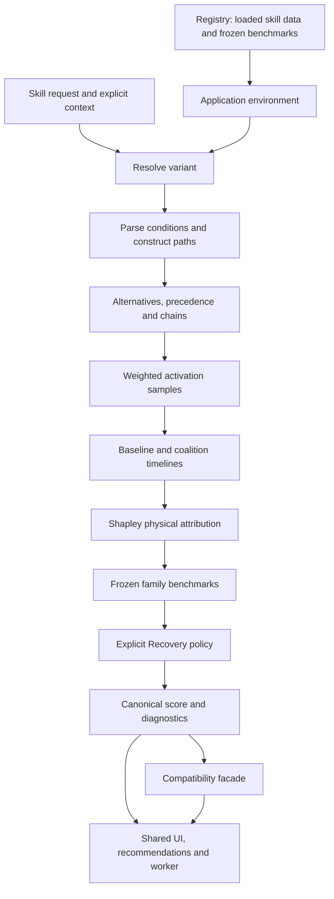

# Canonical skill rating: implementation and maintenance guide

Reviewed: **2026-10-09**. Model: **`conditional-v2`**. Recovery policy:
**`recovery-policy-v1`**. Tier policy: **`conditional-tier-v1`**.

This is the current technical reference for AlmondEyeDB skill ratings. It describes
the working-tree implementation, including the rating refactor that is not yet
fully represented by the repository's committed history. Read the
[known issues / next pickup](#known-issues--next-pickup) before changing trigger
selection, condition labels, mechanics or benchmarks.

The following evidence labels apply throughout:

- **Implementation:** behavior established by the current code and local CLI checks.
- **Product policy:** an intentionally chosen rating convention, not a game formula.
- **Provisional mechanics:** an approximation or inference; not validated by real races.
- **Open finding:** a confirmed implementation issue or a stated verification gap.

Earlier category scores, rank penalties, consistency bonuses and tier overrides
in [skill_eval.md](skill_eval.md) and [skills-spurt.md](skills-spurt.md) are historical.
The [replay analysis](race_skill_rules_analysis.md) is research context, not the
current rating specification. Its observations do not establish activation
probabilities for this conditional engine.

## Contents

1. [Meaning of a rating](#meaning-of-a-rating)
2. [Architecture and public API](#architecture-and-public-api)
3. [Conditions and trigger scenarios](#conditions-and-trigger-scenarios)
4. [Simulation and effect handlers](#simulation-and-effect-handlers)
5. [Attribution, benchmarks and Recovery policy](#attribution-benchmarks-and-recovery-policy)
6. [Application integration and performance](#application-integration-and-performance)
7. [Reproduced case studies](#reproduced-case-studies)
8. [Known issues / next pickup](#known-issues--next-pickup)
9. [Maintenance and verification](#maintenance-and-verification)

## Meaning of a rating

### Conditional value

A rating evaluates one resolved skill variant on a specific course, style, racer
count, race configuration and stat profile, **assuming its highlighted dynamic
conditions are satisfied**. Rank, blocked time, overtaking and external skill
prerequisites do not multiply the score by their probability of occurring.
Wisdom activation chance and the number of opponents do not multiply it either.

Hard course/style/stat/race gates are checked. Supported intrinsic conditions are
checked against the simulated timeline, so static eligibility does not guarantee
that an activation will occur. An assumption is not evidence that the model
reproduced an opponent interaction. Unknown conditions stay explicitly unverified.

The score is unbounded and may be negative. Category describes a tactical role;
it does not assign points or override a tier. Positive self-healing has an
additional [product policy](#recovery-product-policy), so score is not exclusively
an estimate of finish-time gain.

### Three independent axes

| Axis | Values | Meaning |
|---|---|---|
| `eligibility.state` | `eligible`, `ineligible`, `missing-context`, `unknown` | Whether analysis establishes a conditional path in the supplied context. |
| `activationOutcome` | `activated`, `not-activated`, `unmodeled` | Whether modeled effects fired in the selected scenario's samples. `activated` means at least one sample fired, not a measured race probability. |
| `status` | `complete`, `provisional`, `partial`, `unavailable` | How much of the value is modeled and can be normalized. |

The current implementation uses `complete` for a definitive static rejection.
Scored modeled effects remain `provisional`. Unsupported effects/metadata or
missing benchmarks produce `partial`; incomplete context, unresolved variants
and mismatched model benchmarks can produce `unavailable`.

An OR expression can remain eligible through a known branch even when another
branch is unknown. Path-specific omissions are attached to their own paths;
analyzer-level failures, such as parsing or branch-budget failures, affect the
returned rating more broadly. Consult `partialReasons` as well as eligibility.

### Interpreting zero and missing values

| Situation | Current behavior | Interpretation |
|---|---|---|
| Hard gate fails, no valid path | Score 0, `ineligible`, `complete`, F / 1 star | A verified conditional rejection in this context. |
| Valid static path, intrinsic condition never passes | Score 0, `not-activated`, usually `provisional` | No selected modeled activation; see the fallback finding below. |
| Effect fires but does not improve the race | Physical gain 0; score may be 0 | For example, acceleration while already at the target speed. |
| Positive self-heal at course length <=2000m | Positive self-heal points 0 | A product gate; physical healing and eligibility are unchanged. |
| Full-HP heal on a longer course | Physical benefit may be 0, reserve points may be positive | Nominal reserve is intentional product value. |
| Missing benchmark or handler | Partial modeled score; tier/stars `null` | A numeric 0 here is not a verified zero total value. |
| Missing context, unresolved variant or wrong benchmark version | `unavailable`; numeric score defaults to 0 | Display unavailable, not a genuine zero-point claim. |

`partial` and `unavailable` suppress full-skill tier/stars. For other statuses,
[policy.ts](../lib/skill-rating/policy.ts) supplies the only tier table:

| Score interval | Tier | Stars |
|---|:---:|---:|
| >=120 | S | 5 |
| >=90 and <120 | A | 4 |
| >=65 and <90 | B | 3 |
| >=40 and <65 | C | 2 |
| >=20 and <40 | D | 1 |
| <20 | F | 1 |

## Architecture and public API

### Data flow and ownership



The domain entry point is [lib/skill-rating/index.ts](../lib/skill-rating/index.ts).
It exports the contract, session and policies without importing React, storage
or runtime JSON. [application.ts](../lib/skill-rating/application.ts) is the
application adapter in the same directory: it imports registry lookups and the
PVP ban policy. Do not mistake that adapter for the pure algorithm boundary.

[lib/data/registry.ts](../lib/data/registry.ts) is the only application module that
imports runtime JSON. Offline scripts may read source/generated files directly.
The generic zone engine establishes geometry; canonical analysis adds actual
profile gates, rank consistency, assumptions and trigger relationships.
A drawn activation window alone does not establish an activation or a score.

### Inputs

The exact types live in [types.ts](../lib/skill-rating/types.ts).

| Input | Important fields and defaults |
|---|---|
| `RatingContext` | `course`, `style`, `racerCount`, optional `raceParameters`, required `profile`; optional `modelVersion` and `hpEnvironment`. |
| `RatingRequest` | Full `skill` content; `variant` defaults to `original`. |
| `RatingEnvironment` | Loaded `benchmarks`; optional `resolveVariant` and `isSkillAllowed` callbacks. |
| `profile` | Versioned raw panel stats and persisted `dynamicOverrides`. Dynamic probability overrides do not scale canonical conditional ratings. |
| `hpEnvironment` | Session default is `{ competition: "conditional" }`; fixtures can request `"none"`. |
| `modelVersion` | Session default is `conditional-v2`; must match the frozen benchmark artifact to evaluate a score. |

Styles are 1 Runner, 2 Leader, 3 Betweener, 4 Chaser, 5 Great Escape.
The standard profile is Speed 2200, Stamina 1800, Power 1700, Guts 1500,
Wisdom 1800, with empty dynamic overrides. Ground condition defaults to Good
in physical simulation; an explicit condition such as `ground_condition==1`
still needs the corresponding analysis context value.

Callers must supply valid, normalized domain inputs. Analysis explicitly checks
course length and positive integer racer count; it is not a complete validator
for every numeric field in an arbitrary external context.

### Session usage

```ts
import { createSkillRatingSession } from "../lib/skill-rating";
import type { RatingContext, RatingEnvironment, RatingRequest } from "../lib/skill-rating";

function inspectSkill(
  context: RatingContext,
  environment: RatingEnvironment,
  request: RatingRequest,
) {
  const session = createSkillRatingSession(context, environment);
  const analysis = session.analyze(request);
  const summary = session.evaluate(request); // default: summary
  const full = session.evaluate(request, { detail: "full" });
  const repeated = session.evaluateMany([request, request], { detail: "summary" });
  return { analysis, summary, full, repeated, metrics: session.metrics() };
}
```

In application code, use `createApplicationRatingSession(context)` or
`useSkillRatingSession(...)` to get the registry-backed environment.
Keep one session for a common course/style/profile batch. Construct a new session
when context, metadata resolution or frozen benchmarks change.

| Method | Behavior |
|---|---|
| `analyze` | Resolves the variant, parses gates and constructs paths/scenarios without computing a skill score. Session construction may already simulate its baseline. |
| `evaluate` | Selects and scores a conditional scenario; memoizes by request content and detail mode. |
| `evaluateMany` | Synchronous ordered `requests.map(evaluate)` with shared caches; it does not spawn workers or stream results. |
| `metrics` | Diagnostic counts for evaluations, cache hits and counted simulation calls, including child style sessions. Not an exact count of every underlying `runTimeline`. |

`analyze` with `style:null` does not expand styles. `evaluate` with no selected
style and a course evaluates all five styles, picks the highest score among
eligible results (or among all results when none is eligible), and returns
`styleRatings` plus `bestStyle`. Ties retain the earlier style. The parent result
has `selectedStyle:null`; it is not a style-neutral physics run.

### Variant resolution and compatibility

The application environment resolves variants **before** condition, duration and
effect analysis:

- `original`: keep the supplied payload.
- `parent-factor`: Gold rarity 2 resolves to its actual White mapping; other
  rarities are returned as supplied by this adapter.
- `inherited-unique`: resolve through the unique/inherited map. Known inherited
  IDs and rarities 1/4/6 are returned idempotently by the adapter.
- Missing mappings/payloads return unknown/unavailable. Do not fall back to a
  stronger original unique.

The [evaluateSkillForTrack facade](../lib/evaluator/evaluator.ts) preserves its
positional signature and legacy result shape. Parent mode requests parent-factor
for Gold and inherited-unique for unique rarities 3/5. The facade defaults to
`full`, while the canonical session defaults to `summary`; heavy consumers
explicitly request summary. Supplied legacy zones are accepted but do not score
the skill. `projectSkillRating` projects an existing rating without simulation.

Per-trigger compatibility projections retain the selected scenario's overall
score/contributions; they are not independent trigger ratings. The canonical
inspector suppresses the legacy per-trigger verdict display.

### Results and detail levels

| Field group | Interpretation |
|---|---|
| IDs / variant / fingerprint / model | Original request identity, evaluated payload identity and context snapshot. |
| `scenarios` | All analyzer scenarios, including fallback and alternatives not selected for scoring. |
| `selectedScenarioId`, `selectedPaths` | The actual scenario used to compute returned scalar values. |
| `assumptions` | Analysis: union of paths' assumptions. Evaluation: assumptions of selected paths only. |
| `contributions` | Family, raw attributed benefit, physical benchmark, simulation points, policy points and total points. |
| `simulatedBenefit`, `timeGainSeconds` | Physical relative benefit only; nominal Recovery reserve is excluded. |
| `recovery` | Weighted nominal/received/wasted HP, activation records, simulation weighting and reserve calculation. |
| `hp` | Baseline/skill spurt start, final plan, distance, finish HP, depletion and Limit Break state for a representative sample. |
| `breakdown`, `provenance` | Explanation, assumptions and recorded reference provenance. Provenance is not proof of fresh verification. |
| `trace`, `distribution`, `hpEvents` | Full-only detail; representative HP/time trace plus sampled physical gain distribution. |

Summary/full share score, eligibility, tier and scalar breakdown. Summary still
collects actual Recovery activation records needed for policy; it does not
allocate frame points or HP event logs. Full adds detail with additional runs,
not a different scoring formula. See [K6](#k6-performance-and-representative-detail)
for representative-sample limitations.

## Conditions and trigger scenarios

Source: [conditions.ts](../lib/skill-rating/conditions.ts) and
[intrinsic-conditions.ts](../lib/skill-rating/intrinsic-conditions.ts).

### Grammar and rank sets

Canonical analysis uses the existing Pratt parser with a proxy that preserves
unknown identifiers. `&` is AND, `@` is OR with looser binding; comparators are
`==`, `!=`, `<`, `<=`, `>` and `>=`. Expressions expand into branches, with a
64-branch budget. Precondition/condition combinations and chain scenarios also
have budgets; overflow is reported rather than silently treated as complete.

Ranks are discrete integers in `[1, racerCount]`. Conditions within one branch
intersect their rank sets; OR branches retain separate paths. An empty rank set
rejects that branch. `order_rate` currently compares rank against
`Math.round(racerCount * threshold / 100)`, using the original comparator.
For example, at 9 racers `order_rate>50` permits 6–9; at 12 racers
`order_rate>=40&order_rate<=80` permits 5–10. This is the implementation's
rounding convention, not a newly validated game formula.

Continuous in/out rank predicates preserve both the rank constraint and an
assumption about maintaining it. A range outside the style's expected envelope
produces a warning, not a penalty, forced F tier or activation ban.

### Gate classification

| Kind | Examples | Treatment |
|---|---|---|
| Static context | `distance_type`, `course_distance`, `running_style`, raw `base_*`, terrain, rotation, configured season/weather/ground | Compare explicit values; reject mismatches. Missing required values stay unknown. |
| Geometry | Phase, corner/straight, slope, distance rate, remaining distance | Filter physical regions using shared condition operators. Unsupported operators stay partial/unknown. |
| Modeled intrinsic | `hp_per`, `accumulatetime`, `is_lastspurt`, `is_fullspeed`, supported `run_at_full_speed_random` | Carry clauses to the simulator; check current state without an assumed label. |
| Dynamic race state | Blocked, near rivals, overtaking, rank | Conditional assumptions; some also influence the timing distribution. |
| External prerequisite | Another skill activated/used | Explicit assumed prerequisite/dynamic state; no external skill probability multiplier. |
| Historical or unsupported intrinsic | Intrinsic predicate in a precondition; `lastspurt`, `is_hp_empty_onetime` | Assumed with a partial reason; not claimed as verified timeline history. |
| Unknown identifier/context | Unrecognized condition, absent required race value | Explicit unknown assumption/reason, not verified true. |

`is_fullspeed` currently compares physical velocity to an intrinsic target with
0.02 m/s tolerance. That target is the spurt plan or phase base target, not a
complete recomputation of all active target-speed modifiers. Supported Zenkai
random state is only `run_at_full_speed_random==1`; it also has a raw Speed
>2000 analysis gate and a candidate late region. Simulator Zenkai uses raw Speed
plus skill stat modifiers, so those two gates are not interchangeable.

### Precondition history

Precondition rank and activation rank are different snapshots. For example,
precondition `order==1&phase==1` followed by activation `order==2` is not rejected
as a simultaneous rank contradiction. Historical rank/dynamics are assumed.
Precondition geometry must have a feasible region; its earliest start constrains
later activation regions. The engine does not replay a full rank/blocking history.
An intrinsic precondition remains partial even if that same predicate is modeled
as a current activation condition.

### Relationships between details

A condition group index becomes `triggerIndex` (zero based; UI shows +1).
OR/precondition combinations can create multiple paths for the same group.

| Relationship | Current implementation |
|---|---|
| Single | One root and its chosen path. |
| Alternative | Independent roots are scored as separate scenarios; choose the highest conditional score. No addition of mutually exclusive roots. |
| Enhanced/fallback | Strict condition implication establishes precedence across different groups. Preconditions and activation conditions are namespaced separately; same-group OR paths do not suppress each other. |
| Chain | `is_activate_other_skill_detail==1` links a later group to previous source indices. Later effects require a preceding detail to have fired on the common timeline. |
| Ambiguous overlap | Overlapping roots without established implication, or equivalent conditions with different payloads, are flagged partial; the best conditional scenario is reported. |

Implication checks individual same-name clauses across comparison boundaries; it
is not a general-purpose symbolic theorem prover. A detail continuation cannot
become a standalone root when its earlier source path was filtered out. Current
chains use an any-previous-index dependency, not a complete explicit game detail
state machine. Negative detail dependencies are partial.

**Current precedence caveat:** the session suppresses fallback when an analyzed
enhanced scenario exists and has no unknown assumptions, before checking whether
its intrinsic conditions actually pass in simulation. This is a confirmed issue,
not intended fallback behavior; see [K2](#k2-fallback-suppressed-before-intrinsic-activation).

### Timing samples and real fires

Source: [sampling.ts](../lib/skill-rating/sampling.ts). Non-immediate paths use
12 deterministic samples by default, each with weight `1/12`.

| Policy | Position selection |
|---|---|
| Immediate | Request the start of the first valid region. The simulator fires on the first actual frame at/after that meter satisfying intrinsic conditions and region membership. |
| Random | Stratified midpoints over the union of eligible intervals, allocated by interval length. A long interval contributes more probability mass. |
| Straight | Seeded equal selection among usable regions, then a position within the chosen region. |
| All-corner | Seeded selection without replacement of up to four usable corner intervals; fire at the earliest rolled position. |
| Distribution | Seeded Erlang/gamma quantiles, normalized by sample min/max and mapped into eligible physical length. A timing convention, not measured activation probability. |

The current sampling helper excludes the last 10m of a region when choosing or
clamping random positions (`span = max(0, end-start-10)`). Uniform/distribution
mapping still allocates mass by the full interval length. Narrow intervals can
therefore collapse to their starts; document this approximation when comparing
small windows. Do not describe these finite samples as exact integration.

Typical dynamic distributions use shape 3/rate 2; lane movement uses 5/1;
overtaking uses 1/2. Explicit `_random` predicates can replace a dynamic
distribution. Sampling comes from activation conditions, not the precondition's
historical timing policy. Joint chain samples are a Cartesian product with
multiplied weights. The best sampled point is diagnostic, never substituted for
the weighted rating.

Group `cd` is converted to seconds with `/10000`. The path's additional activation
count is the maximum effect-level `additional_activation`. The simulator permits
up to one initial fire plus that many repeats when cooldown exists and the path
remains valid. Without cooldown it stops after the initial fire. Additional
activation is still marked partial by analysis; [K4](#k4-additional-activation-is-only-a-basic-repeat-model)
explains the distinction between working repeat tests and complete semantics.

## Simulation and effect handlers

Source: [simulator.ts](../lib/skill-rating/simulator.ts). These formulas describe
the present model; they do not certify game accuracy.

### Units and duration

- Distance: metres; velocity: m/s; acceleration: m/s²; time: seconds.
- Effect values generally divide by 10000: target speed 3500 -> 0.35 m/s;
  heal 150 -> 0.015 of maxHP; passive 400000 -> +40 stat.
- Timed duration: `base_time / 10000 * course.length / 1000` when supported.
  Base 50000 at 3000m gives 15s, not 5s.
- Groups consisting entirely of passive types 1–5 are persistent with
  `seconds:null`; groups consisting entirely of types 9/10/14 are instant.
- Other missing/nonpositive durations or unsupported nonzero `time_scale` are
  unknown/partial. Mixed groups follow the group duration classification.
- `value_scale` is preserved but unsupported; nonzero values produce partial.
  These paths can still return the modeled base-value portion, not a complete
  scaled effect value. Unknown duration does not establish a timed benefit.

Geometry retains `{start,end}`. Raw slopes retain their stored values for zones
and rendering: **20000 means 2%**. Only the physics formula divides by 10000.

### Classification and coverage

[lib/evaluator/effects.ts](../lib/evaluator/effects.ts) owns type/family/target/sign
classification. Self-benefit, self-cost and opponent targeting are separate.
Targets 0/1 (or omitted) are self; 4/7/9/10/18/19/20/21/22/23 are opponents;
2 is all, 11 is allies, and other IDs are unknown. All/allies/unknown scope is
not simulated as a self/opponent substitute; ratings disclose partial scope.

| Types | Family | Physical lifecycle | Support at this review |
|---|---|---|---|
| 1/2/3/4 | Passive Speed/Stamina/Power/Guts | Update the relevant stat; Stamina updates maxHP and current HP by the cap difference. Remove stat modifiers at expiry if timed. | Provisional; physical benchmarks present. |
| 5 | Passive Wisdom | Update Wisdom; can affect supported rarity-dependent speed magnitude in a mixed skill. No independent activation probability value. | Handler present; no positive frozen benchmark, so partial. |
| 9 | Recovery | Signed fraction of current maxHP; clamp HP to `[0,maxHP]`. Record actual positive self-heal activations for policy. | Provisional physics plus explicit product policy. |
| 10 | Start Delay | Multiply initial delay when firing at meter 0. | Provisional; `<10000` classifies as benefit, larger/equal as cost. |
| 14 | Start Delay | Add signed seconds to initial delay at meter 0. | Provisional handler; sign descriptor is conditional. Shares family benchmark with type 10. |
| 21 | Current Speed 21 | Add displacement speed while active; the timed bonus disappears on expiry. | Provisional. |
| 22 | Current Speed 22 | Add displacement speed while active; add its signed value to physical velocity at expiry, then normal integration applies. | Provisional; different lifecycle from 21. |
| 27 | Target Speed | Add to target velocity; physical acceleration/deceleration reaches the changed target. | Provisional. |
| 31 | Acceleration | Add to acceleration while velocity is below target; not a categorical timing bonus. | Provisional; zero benefit can be valid. |
| 48 | Zenkai | Modify the provisional acceleration ramp by `(value/10000)*0.1` while Zenkai is active. | Provisional. |
| 6/8/13/28/29/32/35/37/38/41/42/49/50/501/502/503 | No canonical family | No handler in the reviewed dataset coverage. | Explicitly unsupported/partial when part of the selected scenario. |

The coverage list comes from effect types in `skillsById`, including inherited
payloads, at the review snapshot. New dataset types require a fresh audit.
Names/icons/tags do not supply a substitute handler or arbitrary score.

### Timeline and benefit units

Integration uses `DT = 1/15s`, starts at 3 m/s with 0.1s delay, and clips the last
frame to the finish. The loop has a 15000-frame guard; do not assume arbitrary
out-of-contract profiles were validated through that guard. Phases use explicit
course bands or fall back to boundaries D/6, 2D/3 and 5D/6. Last-spurt state is
HP/planner driven and can differ from course phase 3.

Each frame expires effects, checks pending activations, updates the spurt plan
when appropriate, updates competition/Limit Break/Zenkai, computes target and
acceleration, then integrates movement and HP. A supported intrinsic predicate
may delay a sampled request until a later valid frame within the path's region.
A later chain trigger failing does not erase effects already earned by its root.

For self effects, compare against a shared no-skill baseline. For opponent effects,
run one representative target with the same selected profile/style/environment:

```text
timeGainSeconds = baselineFinish - selfFinish + opponentFinish - baselineFinish
simulatedBenefit = timeGainSeconds * raceBaseSpeed(courseLength)
bashin = simulatedBenefit / 2.5
```

When no opponent effect exists, opponentFinish equals baselineFinish. Benefit is
a **time-equivalent distance**, not the literal final spatial gap of a multi-runner
race. Opponent healing can be negative relative value; self-costs can also be
negative. No multiplier for lobby size is applied. Full trace shows baseline and
self timelines; it does not plot the representative opponent's altered timeline.

### HP, speed and stat equations

Source: [hp-physics.ts](../lib/skill-rating/hp-physics.ts). In these equations,
`D` is course length, `s` is style, `S/P/G` are effective Speed/Power/Guts, and
`H` denotes HP. Raw panel stats are reduced above 1200 once, then skill stat
modifiers are added:

```text
adjusted(x) = x                         if x <=1200
            = 1200 + (x-1200)/2         otherwise
effectiveStat = max(1, adjusted(rawStat) + skillModifier)
B = raceBaseSpeed = 20 - (D-2000)/1000
maxHP = D + 0.8 * hpStyleCoefficient[s] * effectiveStamina
baseTarget(phase) = B * phaseCoefficient[s][min(2,phase)]
                  + (phase>=2 ? sqrt(500*S)*0.002 : 0)
maxSpurt = (baseTarget(2) + 0.01*B)*1.05
           + sqrt(500*S)*0.002 + (450*G)^0.597*0.0001
minimumSpeed = 0.85*B + sqrt(200*G)*0.001
HPperSecond(v,phase) = 20*(v-B+12)^2/144 * groundFactor
                      * (phase>=2 ? 1+200/sqrt(600*G) : 1)
```

| Style | Phase 0 | Phase 1 | Phase 2+ | HP coefficient |
|---|---:|---:|---:|---:|
| Runner | 1 | 0.98 | 0.962 | 0.95 |
| Leader | 0.978 | 0.991 | 0.975 | 0.89 |
| Betweener | 0.938 | 0.998 | 0.994 | 1 |
| Chaser | 0.931 | 1 | 1 | 0.995 |
| Great Escape | 1.063 | 0.962 | 0.95 | 0.86 |

Ground factor is 1.01 for Dirt with condition 3, otherwise 1.02 for condition
>=3, otherwise 1. HP burn uses physical velocity after its frame update, before
type 21/22 displacement bonus, and the usable frame duration. Longer spurt at the
same physical speed/state therefore consumes more HP. Type 22's expiry impulse
subsequently affects physical HP burn.

Uphill target penalty is `(storedSlope/10000)*200/effectivePower`; downhill mode
is omitted. Power acceleration is `0.0006*sqrt(500*P)`, except the opening 15m
uses 12 m/s² before skill acceleration. Deceleration is -1.2 when HP is empty
or phase 0, -0.8 in phase 1, -1 in phase 2+. Empty HP reduces target to minimum
speed; Zenkai depletion immediately sets physical velocity to minimum as well.

Wisdom above 1200 also modifies the magnitude of types 27/22 for rarities
2/3/5/6 using `wisdomMultiplier` and `wisdomPhaseCoefficient` in the simulator.
This is a modeled effect-magnitude adjustment, not Wisdom activation probability.
It uses raw Wisdom plus skill modifiers. With `delta=max(0,rawWisdom+modifier-1200)`,
the implemented multiplier is:

```text
M = 0                                      if delta=0
  = ceil(delta/20)*0.02                     if delta<=200
  = 0.2 + ceil((delta-200)/20)*0.06          if delta<=400
  = 0.8 + ceil((delta-400)/20)*0.01          if delta<=800
  = min(1.12, 1+ceil((delta-800)/100)*0.01)  otherwise
modifiedEffectValue = rawEffectValue * (1 + M*coefficient)
```

| Style | Phase 0 | Phase 1 | Phase 2+ outside spurt | Actual spurt |
|---|---:|---:|---:|---:|
| Runner / Great Escape | 0.26 | 0.23 | 0.19 | 0.16 |
| Leader | 0.21 | 0.21 | 0.21 | 0.21 |
| Betweener | 0.19 | 0.18 | 0.23 | 0.24 |
| Chaser | 0.15 | 0.17 | 0.25 | 0.27 |

The coefficient is read at activation. Passive-only Wisdom has no independent
finish benefit in the current baseline. These piecewise rules are the current
model's implementation; their presence is not a fresh mechanics validation.

### Last-spurt planner

Source: [last-spurt.ts](../lib/skill-rating/last-spurt.ts). Planning begins in
phase 2. The mechanics document introduction mentions mid-race, while the detailed
paragraph and recorded solver provenance use phase 2; the choice is disclosed.

1. Set remaining budget distance `R=max(0,D-60-currentMeter)`.
2. Test immediate maximum spurt, including the potential Limit Break increment.
3. Otherwise evaluate candidates decreasing maximum speed by 0.1 m/s to cruise.
4. Solve cruise/spurt distances against HP, then choose the feasible candidate
   with the shortest estimated finish. No Wisdom acceptance roll is applied.
5. Physical integration still runs and burns HP all the way to the actual finish.

For cruise speed `c`, candidate `v`, their HP rates `q(c)`/`q(v)`, and spurt
seconds `t`, the candidate budget is:

```text
normalDistance = R - v*t
Hneeded = normalDistance/c*q(c) + t*q(v)
t = (c*availableHP - q(c)*R) / (c*q(v) - q(c)*v)
```

The code clamps time to `[0,R/v]`, rejects infeasible/degenerate budgets and
includes the final up-to-60m travel time in the time estimate. If even cruise is
infeasible, it returns a cruise fallback and lets integration handle depletion.
A positive HP recovery in phase 2+ replans before target-speed integration. When
already spurting, candidates cannot introduce a new waiting/cruise interval.
HP cost/debuff does not initiate replanning. Limit Break persists once activated.
Future skill buffs, acceleration ramps, slope variation and optional competition
are not fully forecast by the constant-speed candidate budget.

### Limit Break, Zenkai, competition and Stamina Keep

Limit Break checks **raw Stamina + skill modifier >1200**, not the adjusted stat:

```text
buff = sqrt(thresholdStamina-1200)*0.0085*distanceFactor*0.9865
```

Distance factors are 0 below 2101m, 0.5 for 2101–2200m, 1 for 2201–2400m,
1.5 for 2401–2600m, and 1.8 above 2600m. The 0.9865 factor is a weighted
midpoint convention from the reference table, provisional because its connection
to Power is not established. It activates at near maximum-spurt velocity
(tolerance 0.02 m/s); the maximum candidate budgets the increment. Healing
changes HP, never raw Stamina or its threshold.

Zenkai needs a maximum-spurt plan, raw Speed plus modifier >2000, HP >0 and
near maximum velocity. Its physical ramp is provisional:

```text
zenkaiVelocity += (0.068*powerAccel/(D/1000)^1.5 + type48Bonus)*DT
```

Extra velocity burns HP on the same timeline. The planner does not forecast that
future ramp. Supported Zenkai predicates check actual modeled state instead of
being relabeled assumed. Unsupported transition predicates remain partial.

Source: [competition.ts](../lib/skill-rating/competition.ts). Baseline and skill
default to one nearby same-style opponent. Competition is allowed in
`[10D/24,15D/24)`, checks every 2s, lasts 2s and imposes a 1s cooldown after
the duration. With the 2s check grid, it can start every 4s; do not equate a
3s cooldown boundary with a guaranteed start every 3s.

```text
competitionSpeed = (2*sqrt(P/1500) + (G/3000)^0.2)*0.1*styleSpeedCoefficient
competitionCost = 20*(styleHPCoefficient*distanceFactor + 0.5)
```

Speed coefficients for styles 1–5 are `[0.8,1,1,1,0.2]`; cost coefficients are
`[1.2,1,1,1,1.5]`. Distance factors are 0.3 through 1800m, 0.5 through 2100m,
0.8 through 2200m, 1 through 2400m, 1.1 through 2600m, otherwise 1.2.
NearFactor 0.5 and cost charged once per activation are provisional conventions.
No isolated Runner or far-from-leader bonus is added.

Stamina Keep compares HP with `1.0375*requiredHP` at checks; it blocks competition
when short. Positive recovery resets/rechecks keeping. `requiredHP` forecasts
normal travel to phase 2 and maximum spurt (including Limit Break) to D-60,
excluding optional competition costs; it does not recursively budget competition
or solve the selected slower spurt plan. The recognition is conditional/immediate,
not multiplied by a guessed Wisdom detection probability.

Downhill mode, Secure Lead, Dueling, Rushed and full lobby positioning remain
outside this model. The mechanics snapshot itself labels several newer systems
as speculative; successful tests validate the chosen implementation, not those
game-mechanics claims.

## Attribution, benchmarks and Recovery policy

### Physical Shapley attribution

Source: [session.ts](../lib/skill-rating/session.ts) and
[policy.ts](../lib/skill-rating/policy.ts). Let `V(A)` be weighted physical benefit
when only attribution groups in coalition A are enabled. `V(empty)=0`.
Exact Shapley allocation is:

```text
phi_i = sum over A excluding i:
        |A|!*(n-|A|-1)!/n! * (V(A union {i}) - V(A))
sum(phi_i) = V(all)
familySimulationPoints = 100*familyAttributedBenefit/familyBenchmark
```

Coalitions keep all selected timeline paths, filtering their effects by group;
they do not reselect a trigger scenario per coalition. The same baseline is
reused. A per-scenario mask cache prevents repeated coalition runs. Interaction
benefit/cost is allocated rather than credited independently to every effect.
Multiple effects in one family share its group, except Recovery is split into
`recovery:self-heal` and `recovery:signed-other`, then projected back to the
Recovery family. Negative attributions are retained.

Partial ratings sum known numeric components without full tier/stars. For a
missing non-Recovery benchmark the physical component is null even if the
family's numeric combined field falls back to 0; consumers must read status,
benchmark and partial reasons, not infer complete zero value from that fallback.

### Frozen benchmark generation

Source: [build-skill-rating-benchmarks.ts](../scripts/build-skill-rating-benchmarks.ts).
The artifact is [skill-rating-benchmarks.json](../lib/data/generated/skill-rating-benchmarks.json).
Benchmarks are a versioned **product ruler**, shared across tracks/styles/profiles.
Changing selected context changes the skill's value, not its benchmark.

The builder reads original/inherited generated datasets, requires one group
with one effect, rejects unsupported family/target, nonzero time/value scaling,
additional activation and zero payloads. It excludes additive start-delay type
14 from benchmark selection, and excludes non-beneficial multiplicative delay.
Timed candidates must have positive known base duration.

Payload identity is `[type, normalized target, value, base_time]`, not skill ID
or name. Per family, the lowest available priority pool is used: rarity-1 White
(non-inherited) first, IDs 900000–999999 inherited next, other payloads last.
If White exists for that family, the builder does not mix in lower-priority
payloads simply to increase its count. Original skill conditions/cooldown are
replaced by synthetic unit-effect fixture paths.

Fixtures are D=1200/1600/2000/2400/3200m × styles 1–5 × Stamina 800/1200/1800,
Good Turf, nine racers, standard other stats, no slopes/corners and default
conditional competition. Timing is meter 0 for passives/start delay, 2D/3 for
acceleration, 0.8D for Zenkai, 0.5D for other families. Take the median of
benefits >1e-7 across selected payloads and fixtures. Artifact `fixtures` counts
positive retained results, not all attempted simulations.

The nominal Recovery benchmark uses actual positive self-heal nominal HP on
fixtures >2000m with mid-race timing; it does not filter those records by positive
finish gain. It has a separate median and a separate 100-point component.

| Family / component | Benchmark benefit, rounded | Payloads | Retained fixtures |
|---|---:|---:|---:|
| Target Speed | 0.722201297 | 8 | 585 |
| Current Speed 21 | 1.032368274 | 4 | 150 |
| Current Speed 22 | 0.665658132 | 3 | 221 |
| Acceleration | 3.288235663 | 9 | 599 |
| Zenkai | 0.688260174 | 1 | 46 |
| Recovery physical | 5.496292147 | 4 | 78 |
| Passive Speed | 0.647400005 | 6 | 217 |
| Passive Stamina | 1.962681016 | 4 | 71 |
| Passive Power | 0.361675316 | 4 | 155 |
| Passive Guts | 0.093785875 | 3 | 147 |
| Passive Wisdom | Unavailable: no positive benchmark | — | — |
| Start Delay | 0.034132877 | 1 | 75 |
| Recovery nominal HP | 84.632 HP | 4 | 60 |

Physical benchmarks use time-equivalent metres; the reserve benchmark uses HP.
Table values are rounded for reading; runtime uses the JSON's full precision.
Do not copy these constants into consumers. A missing or mismatched benchmark
is a disclosed limitation, not permission to invent a fallback normalization.

Historical v1.1 fixed slope units. The fixtures are flat, so that specific fix
did not change their ruler. V2 regenerated physical benchmarks for the changed
HP/spurt/competition baseline and added the Recovery reserve benchmark.

### Recovery product policy

Source: [recovery-policy.ts](../lib/skill-rating/recovery-policy.ts).
Only **positive self-healing** receives these product adjustments. Signed costs
and opponent HP changes retain their physical points.

For each actual self-heal activation, including repeats and each sampled timeline:

```text
nominalHP = currentMaxHP * healFraction
receivedHP = actual clipped HP increase
wastedHP = max(0, nominalHP-receivedHP)
phaseWeight = 0.5 for phase 0, otherwise 1
```

With sampling weight `w`, physical Shapley self-heal points `Pself`, and signed
cost/opponent points `Psigned`:

```text
nominal = sum(w*nominalHP)
weightedNominal = sum(w*phaseWeight*nominalHP)
simulationWeight = weightedNominal/nominal (1 if nominal=0)
distanceGate = 1 if D>2000, otherwise 0
reservePoints = 100*weightedNominal/nominalHPBenchmark
simulationPoints = distanceGate*simulationWeight*Pself + Psigned
policyPoints = distanceGate*reservePoints
recoveryPoints = simulationPoints + policyPoints
score = sum(all family total points)
```

Early/mid/late attribution is therefore weighted by nominal HP of actual fires,
not a separate coalition for each activation. HP recovery itself is never
halved or disabled by the rating policy. Overflow still earns reserve value
on longer tracks; its wasted HP is disclosed. No activation earns no reserve.
The 2000/2001m boundary is deliberate. Missing reserve benchmark is only needed
when distanceGate is 1 and actual nominal self-heal is nonzero.

The physical and reserve benchmarks each normalize their component to 100.
Adding them is the requested product policy, not two independent measured time
benefits; a Recovery skill can exceed 100 when both contribute. Physical seconds,
metres, bashin, trace/distribution and `usefulRate` exclude reserve points.

## Application integration and performance

### Consumers and separate policies

| Consumer | Role and constraints |
|---|---|
| Inspector / shared skill detail | Canonical summary, exact assumed clauses, partial reasons and optional full trace. Current fallback-label issue is K1. |
| Visualizer | Canonical paths produce activation zones; physical trace/distribution uses the same rating context. Course phase and spurt state remain distinct. |
| Support-card recommendation | Reuses a session; course-aware skill quality comes from canonical score. Card skill coverage, access/ownership and event-chain choices remain card-level concerns. No category bonus replaces skill quality. |
| Parenting / factor matching | Resolve actual inherited/White data and use canonical eligibility/score. Minimum-effect eligibility is a separate product filter. |
| Parenting recommendation worker | Receives serialized course/style/race/profile and calls the same domain adapter. Returns one full recommendation response or error; no incremental batches. |

The shared hooks are [use-skill-rating-session.ts](../app/common/hooks/use-skill-rating-session.ts)
and [use-race-impact-profile.ts](../app/common/hooks/use-race-impact-profile.ts).
They share profile/context conventions; there is not one global cross-tab cache.
Each hook/session instance has its own memoization. The worker request omits
explicit model/policy/competition fields; those defaults come from the same
bundled code/environment rather than a client-selectable version handshake.

Parenting's [minimum-effect filter](../lib/parenting/unique-effect-filter.ts)
requires one independently qualifying self effect on an analyzed feasible path:
raw value >=1000 for speed/current-speed/acceleration/Zenkai, or >=150 for heal.
It excludes nonzero value scaling, does not sum weak effects, and does not count
opponent debuffs. Without a course it performs only the inherited payload floor.
This policy is not a substitute for rating or proof of intrinsic timeline activation.

Recommendation card totals aggregate relevant skill scores and selected event
choices; they are not a six-card deck joint simulation. Without a course,
recommendation uses separate source/specialization fallback weights, not a
canonical skill rating. Character style recommendation combines aptitude grade
value with eligible non-partial kit ratings; it is not the canonical `bestStyle`
selection algorithm. Keep these meanings distinct in UI/docs.

Legacy race-impact fields project conditional results: probability factors are
1, geometry/activation indicators describe modeled availability, and facade
`usefulRate` is based on positive aggregate physical gain. Full distribution
samples carry their own modeled activation/usefulness flags. Neither is a
calibrated real-race frequency. Dynamic priors are retained for call compatibility,
not used to multiply canonical score.

### Cache and cost boundaries

The session clones context, defaults model/environment and constructs its baseline
once per fixed style. Context fingerprint is canonical sorted JSON, not an opaque
hash. Per-session request keys include full skill content and variant; context
is implicit in that session. The environment is captured by reference: callers
must keep lookup/benchmarks stable and create a new session when they change.
Cached results are returned as objects; treat them as read-only.

Analysis and summary/full results have separate caches. A scenario caches
coalitions by bit mask. Duplicate requests in a batch hit the cache; candidate
callers should additionally deduplicate skill IDs before projecting them onto
cards. Full detail reruns the selected samples and a representative traced
simulation; it does not reuse every summary coalition run's stored frames.

For k random chained paths, joint timing can grow as `12^k`; n attribution groups
need up to `2^n-1` nonempty coalitions. The 64-branch cap is not a global simulation
budget. `evaluateMany` does not yield to the main thread. The current Parenting
worker provides isolation but not progress streaming; some card UI uses scheduled
small batches. Extending heavy candidate analysis must account for both limits.

Historical local performance observation retained from the earlier refactor:
Kyoto 3000m, Betweener, standard profile, 5555 card grants deduplicated to 631
skills; v1.1 took about 1.88s / 2821 counted simulations, v2 about 2.17s / 2869.
Repeated evaluation took about 1.9ms with 631 cache hits and no extra counted
simulations. **These timing measurements were not rerun in this documentation
review**, and are not a stable latency guarantee.

### Persistence and format compatibility

Ratings are derived, not stored in presets or V4 share links. Keep existing
profile version/storage, preset keys, Parenting storage, IndexedDB and V4 codec
semantics. No rating-state migration is needed. A changed model does require
matching benchmark/version changes and fresh sessions, not editing saved users'
stats or adding legacy share decoders.

## Reproduced case studies

These CLI observations were rerun during this review on 2026-10-09. They are
model snapshots, not in-game ratings or acceptance thresholds for future models.
All use the original variant and the application environment:

```text
trackId = 10008 (Kyoto), courseId = 10810, length = 3000m
style = 3 (Betweener), racerCount = 12, groundCondition = 1 (Good)
profile.version = 1
stats = { speed:2200, stamina:1800, power:1700, guts:1500, wisdom:1800 }
dynamicOverrides = {}
model = conditional-v2; policy = recovery-policy-v1
competition = conditional (one nearby same-style representative)
```

| Original skill | ID | Selected trigger / timing | Score | Physical gain, seconds | Status |
|---|---:|---|---:|---:|---|
| Spring Light: Bon Appétit / 春光・Bon appétit | 110761 | Enhanced Trigger 1; immediate, 2473.5–2597m | 606.1657 | 0.230407 | provisional |
| With All My Might / 一所懸命 | 203561 | Trigger 1; random, 2500–2750m | 398.8725 | 0.151614 | provisional |
| Ultra-Long-Distance Recovery ○ / 超長距離回復○ | 204293 | Trigger 1; immediate, 1200–1230m | 90.1078 | 0.045324 | provisional |

Bon Appétit assumes `blocked_side_continuetime>=2` during phase 1 and both
activation rank clauses `order_rate>=40`, `order_rate<=80` (combined positions
5–10 at 12 racers). Its +0.55 m/s effect lasts 15s. The weaker +0.35 m/s branch
is fallback; these do not add together. The UI currently labels only the
selected branch's assumptions, making the fallback rank appear unassumed (K1).

With All My Might's +0.35 m/s lasts 9s. `is_lastspurt` is checked by the simulator,
so this example has no assumptions. Its score averages the random samples;
the displayed optimal sample does not determine it. The raw slope-unit regression
and sufficient/insufficient HP fixtures protect this behavior.

Ultra-Long-Distance Recovery's 1.5% heal is instant, not a missing duration.
It fires at about 1200.7206m, phase 1, at the first valid integration frame.
Current maxHP is 4200, giving nominal/received HP 63 and wasted HP 0:

```text
physical simulation points = 15.667890973
reserve points = 100*63/84.632 = 74.439928160
total = 90.107819132
```

Its hard >=3000m gate and 40–41% distance window are modeled. A longer course
can value nominal reserve even when its physical finish gain vanishes. Do not
relabel a correct instant-heal duration as a parser failure merely because a
previous model returned zero.

To reproduce using the current registry, run the following from the repository
root. It does not modify generated data:

```sh
bun -e '
import {loadRacetracks, skillsById} from "./lib/data/registry";
import {flattenCourse} from "./lib/api/course-format";
import {defaultRaceImpactProfile} from "./lib/race-impact/profile";
import {createApplicationRatingSession} from "./lib/skill-rating/application";
const row = (await loadRacetracks()).find(t => t.id === 10008)!
  .courses.find(c => c.id === 10810)!;
const session = createApplicationRatingSession({
  course: flattenCourse(row), style: 3, racerCount: 12,
  raceParameters: {groundCondition: 1}, profile: defaultRaceImpactProfile(),
});
for (const id of [110761, 203561, 204293]) {
  const rating = session.evaluate({skill: skillsById.get(id)!});
  console.log(id, rating.score, rating.status, rating.selectedScenarioId,
    rating.timeGainSeconds, rating.recovery);
}
'
```

## Known issues / next pickup

Priorities below are maintenance priorities: P1 can incorrectly remove a valid
rating path; P2 affects truthful presentation or verified support; P3 is a
capacity/detail limitation. These findings are recorded, **not fixed by this
documentation change**. Start with K2 and K1, adding regressions before changing
behavior. Do not use the remaining findings to silently alter the chosen product
policy.

### K1: Assumed labels disappear on unselected branches

**P2 — confirmed presentation issue.** Source:
[skill-detail-panel.tsx](../app/common/ui/skills/details/skill-detail-panel.tsx)
passes `canonicalRating.assumptions` filtered by trigger index into condition
chips. Evaluation overwrites the analysis-wide assumptions with selected-path
assumptions in [session.ts](../lib/skill-rating/session.ts).

**Reproduce:** inspect original Bon Appétit with the case-study context. Trigger
1 shows blocked/rank assumptions; Trigger 2's 5–10 rank condition has no assumed
label, although its analyzed fallback path contains rank assumptions.

**Impact:** a user can interpret fallback rank as verified or assume Trigger 2
was independently scored. The selected enhanced value itself is conditional.

**Desired next behavior:** display path-specific assumptions for each shown
branch, and separately identify the scenario used for the overall rating.
Avoid mixing assumptions from different OR branches or substituting analysis-wide
assumptions into the selected rating summary.

**Regression to add:** shared detail rendering for Bon Appétit and an OR group;
both applicable rank branches expose their own assumptions, modeled
`is_lastspurt` remains unlabeled, selected score/summary is unchanged.

### K2: Fallback suppressed before intrinsic activation

**P1 — confirmed rating issue.** Source: the `candidates` filter in
[session.ts](../lib/skill-rating/session.ts) uses analyzed suppressor existence
and absence of unknown assumptions. It does not require suppressor activation
on the actual timeline before removing fallback.

**Reproduce:** in the case-study context, evaluate this synthetic original skill:

```ts
const skill = {
  id: 123,
  rarity: 1,
  conditionGroups: [
    { condition: "phase==3&hp_per>=100", base_time: 30000,
      effects: [{ type: 27, value: 5500 }] },
    { condition: "phase==3", base_time: 30000,
      effects: [{ type: 27, value: 3500 }] },
  ],
};
const both = session.evaluate({ skill });
const fallbackOnly = session.evaluate({
  skill: { ...skill, conditionGroups: skill.conditionGroups.slice(1) },
});
```

Observed: `both` is 0 / `not-activated`; `fallbackOnly` activates and scores
about 329.4049. Enhanced HP cannot be 100% in that late window with this profile.
This isolates the issue without changing rank/blocking assumptions.

**Impact:** an eligible weaker branch can be lost when a stronger branch's
supported intrinsic predicate fails. The current result can still say
`provisional`; no partial warning specifically diagnoses this precedence failure.

**Desired next behavior:** preserve enhanced precedence when its real conditions
are satisfied, permit fallback when intrinsic conditions fail, and never add
mutually exclusive branches or choose their precedence solely by points.
Dynamic assumptions remain conditional rather than probability multipliers.

**Regressions to add:** failed enhanced intrinsic with viable fallback; activated
enhanced suppressing even a higher-scoring weaker payload; weighted random
samples with different intrinsic states; mixed chains/alternatives; summary/full
and facade consistency. Keep existing strict-rank/OR and precedence tests.

### K3: Passive Wisdom has no positive normalization benchmark

**P2 — confirmed support gap, correctly disclosed as partial.** Sources:
[effects.ts](../lib/evaluator/effects.ts), simulator stat handling and frozen
benchmark artifact.

**Reproduce:** an original skill with `always==1`, `base_time:-1`, one type-5
value-400000 effect produces passive_wisdom attributed benefit 0, benchmark null,
partial status and no full tier. The JSON contains no passive_wisdom benchmark.

**Impact:** the existence of a family/handler does not imply a complete rating.
Wisdom can modify eligible speed effects in mixed payloads, but no independent
probability value is credited and a mixed Wisdom contribution still lacks a ruler.

**Desired next behavior:** maintain disclosure until a justified physical
baseline and benchmark can be established. Do not invent activation-chance points
or a stat-value constant merely to fill the table.

**Regression to add if expanded:** standalone and mixed Wisdom behavior,
benchmark generation, missing-benchmark partial status and tier suppression.

### K4: Additional activation is only a basic repeat model

**P2 — confirmed semantic limitation.** Sources: path metadata and partial reason
in [conditions.ts](../lib/skill-rating/conditions.ts); pending event fire counts
in [simulator.ts](../lib/skill-rating/simulator.ts).

**Reproduce:** analyze a supported group with nonzero `additional_activation`.
The path retains cooldown/count and adds `Additional activation behavior requires
explicit activation-state modeling`. Direct timeline tests can exercise repeats,
but that does not clear the canonical partial reason.

**Impact:** repeat credit represents actual fires in this basic model, not
validated game detail-state semantics, reset conditions or negative dependencies.

**Desired next behavior:** keep partial until explicit activation-state handling
and data semantics are verified. Preserve nominal credit only for actual fires.

**Regressions to add if expanded:** cooldown boundary, no-cooldown behavior,
region expiry, additional-count bounds, dependency history and Recovery totals.

### K5: Recorded solver revision cannot be rechecked locally

**P2 — verification gap; not evidence that the formulas are wrong.** Source:
`SIMULATOR_PROVENANCE` and the frozen artifact record solver revision
`40c263ef46f5fbfcdda023127c4d16e0c665f1ea`.

At this review, the mechanics file SHA256 matches
`b50009114debf9b820b2cdd6d252c2d2e5b506d1dda4938ec163fa747a97107a`.
The available checkout `../uma-tools/uma-skill-tools` resolves HEAD to
`6ba5ca07fcfdca96d9fc03d58a50a751bcebddd2`, and `git cat-file -t` cannot find the
recorded revision. This review did not recover/fetch that object or revalidate
formulas against it. The stored provenance is a historical claim, not fresh
verification of a pinned solver.

**Impact:** a future session could unintentionally compare against another
revision and claim it confirmed the recorded source.

**Desired next behavior:** recover the exact reference snapshot, or explicitly
review and version a new source. Do not silently rewrite the hash to current HEAD.

**Verification to add:** resolve the reference object, record availability and
formula cross-check evidence, and synchronize source/model/benchmark provenance.

### K6: Performance and representative detail

**P3 — confirmed architecture limitations; no benchmarked UI failure claimed.**
Source: `jointSamples`, coalition evaluation and `addDetail` in
[session.ts](../lib/skill-rating/session.ts), plus the
[recommendation worker](../features/parenting/workers/slot-recommendations.worker.ts).

**Reproduce by inspection:** k random paths produce a product of sample sets;
full detail reruns those sets. `hp` and trace use sample index
`floor(sampleCount/2)`. Worker posts the entire recommendation result once.

**Impact:** exponential work can exceed an interactive budget; the trace is
neither a mean trajectory nor necessarily the median/best outcome. Physical
score is weighted, while HP spurt diagnostics are representative. Full
`distribution.samples` also omits the sampling weight and uses the root requested
meter as its coordinate, which may differ from actual fire after intrinsic waits.

**Desired next behavior:** label representative diagnostics accurately and retain
weighted scalar scoring. Any future sampling cap, reuse or streaming change
needs an explicit accuracy/performance contract, not an unannounced sweet-spot
shortcut.

**Regressions/measurements to add if expanded:** chain sample budget, candidate
pool simulation/cache counts, weighted scalar parity, no summary trace, and
worker/main-thread consistency with the same serialized context.

## Maintenance and verification

### Change checklist

1. Read this guide, especially K2/K1, and inspect the working tree before editing.
   Do not discard other unfinished refactor work or treat older docs as policy.
2. **New condition:** classify static/geometry/intrinsic/dynamic/history; implement
   supported comparators, exact rank/OR semantics and unknown/partial behavior.
   Share the grammar and add both analysis and timeline regressions as needed.
3. **New effect:** use the one classification table; specify units, scope, sign,
   duration/scaling and lifecycle. Implement the physical handler or disclose
   unsupported status. Test negative costs, finish clipping and mixed interactions.
4. **Physics/policy change:** update model/policy constants as appropriate,
   regenerate compatible physical/nominal benchmarks, review artifact changes,
   and update provenance/guide. Do not reuse an old ruler with different physics.
5. **Consumer change:** use canonical eligibility/score; show partial values
   without full tier; do not infer activation from badge text. Match variant,
   profile, style, racer count and race configuration across worker/UI calls.
6. **Cache change:** recreate sessions for new context/environment; preserve
   summary/full scalar parity and count work on a real candidate pool.
7. Preserve storage and V4 contracts; respect [DESIGN.md](DESIGN.md) for UI work.
   Browser testing belongs to the user unless explicitly requested.

Benchmark regeneration is an intentional data change, not part of this docs-only
review. When authorized after a model change, run from the repository root:

```sh
bun scripts/build-skill-rating-benchmarks.ts
```

That command writes generated JSON; it is not a dry-run. It uses available local
generated original/inherited datasets, which must be synchronized before generation.
When refreshing old generated data, review
[backfill-skill-rating-metadata.ts](../scripts/backfill-skill-rating-metadata.ts)
and the source pipeline for preserved `cd`, `time_scale`, `value_scale` and
`additional_activation`; do not hand-edit dataset semantics in a consumer.

### Regression map and review evidence

| Tests | Evidence they cover |
|---|---|
| [conditions.test.ts](../lib/skill-rating/conditions.test.ts) | Comparator/rank/OR rules, hard/unknown gates, precondition snapshots, metadata, chain construction and implication precedence. |
| [session.test.ts](../lib/skill-rating/session.test.ts) | Conditional assumptions, common tier, Shapley sums/costs, 21/22 lifecycle, zero benefit, version mismatch, summary/full and cache. |
| [hp-model.test.ts](../lib/skill-rating/hp-model.test.ts) | HP equations, planner, Limit Break, competition/keeping, Recovery boundaries/overflow/sampling/repeat, real heal example. |
| [kyoto-regression.test.ts](../lib/skill-rating/kyoto-regression.test.ts) | Real slopes, With All My Might, supported last-spurt label, intrinsic no-fire and heal before later speed effect. |
| [canonical-facade.test.ts](../lib/evaluator/canonical-facade.test.ts) | Canonical projection, variant resolution and self-cost classification. |
| [worker.test.ts](../lib/skill-rating/worker.test.ts) | Actual worker vs main-thread recommendation consistency after context serialization. |
| [skill-rating-summary.test.tsx](../app/common/ui/skills/details/skill-rating-summary.test.tsx) | Partial/unavailable display, exact assumption source, zero-vs-policy explanations and style results. Does not yet cover K1 in the whole detail panel. |

During this documentation implementation, the following command passed with
**69 tests, 0 failures, 468 expectations across 7 files**:

```sh
bun test lib/skill-rating lib/evaluator/canonical-facade.test.ts app/common/ui/skills/details/skill-rating-summary.test.tsx
```

The case-study CLI probes and synthetic K2 reproducer were rerun; their snapshots
are reported above. Source/benchmark/type descriptions were inspected directly.
Existing passing tests do not cover or resolve all six open findings.

Typecheck, full `bun test`, production build and browser checks were **not rerun
for this documentation-only change**. Earlier implementation gates are historical
results, not fresh verification. For later logic changes, run the authorized
CLI gates and report their actual results:

```sh
npx tsc --noEmit
bun test
WRANGLER_LOG_PATH=/tmp/almondeye-rating-build-wrangler.log bun run build
```

Documentation verification checked 75 local file links/anchors, balanced code
fences and `git diff --check`. Only the five intended Markdown files were changed;
`AGENTS.md` reflects the `CLAUDE.md` change through its existing symlink. No source
logic, generated data or user state was changed by this documentation work.

User-owned browser checks: track/style/profile changes; inspector selected and
fallback labels; Visualizer physical trace; picker/recommendation/Parenting;
persistence; V4 round-trip. Do not claim these checks or in-game validation were
completed from CLI unit tests.
